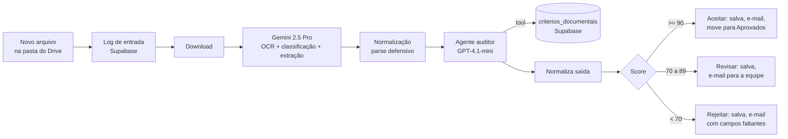

# 01 · Auditoria de documentos com OCR e IA

**Problema.** Equipes de RH e SST recebem dezenas de documentos trabalhistas e de segurança (ASO, NRs, fichas de EPI, PGR, PCMSO...) e precisam conferir, um por um, se cada documento tem os campos obrigatórios. É um trabalho repetitivo e sujeito a erro.

**Solução.** Um pipeline que lê cada documento novo, classifica o tipo, confere os critérios oficiais daquele tipo e decide se aceita, manda para revisão humana ou rejeita. A decisão sempre vem com o motivo e com a lista de campos faltantes.

## Decisões técnicas
- **Critérios no banco, não no prompt.** Cada tipo de documento tem os seus critérios na tabela `criterios_documentais`. Adicionar um tipo novo ou mudar uma regra não exige mexer no workflow nem no prompt.
- **Classificação com lista fechada.** O prompt de OCR mapeia expressões literais para os valores exatos do banco (ex.: "NR-35" e "Trabalho em Altura" viram `NR35`) e proíbe inferências. Se nada bater, retorna `Outro`.
- **Score determinístico.** O agente avalia cada critério individualmente, e o score é `atendidos / total × 100`. As faixas de decisão (<70, 70–89, ≥90) são fixas e o Switch roteia pelo campo `acao`. Assim o LLM não "decide" de forma arbitrária.
- **Humano no circuito.** A faixa intermediária vai para revisão manual em vez de forçar uma decisão binária.
- **Parse defensivo.** Os dois nós de código removem blocos markdown, extraem o JSON com regex, garantem tipos (`safeArray`, `safeNumber`) e devolvem um erro explícito em vez de quebrar o fluxo.
- **Rastreabilidade.** O log de entrada em `logs_documentos` e o registro final em `documentos` guardam score, ação, motivo, campos faltantes, inconsistências e o link do arquivo.

## Status
Demonstração funcional, construída como projeto próprio. Não está em produção.

## Limitações e próximos passos
- A pasta do Drive é verificada a cada minuto (polling), o que é bom para volumes baixos. Para volumes altos, o ideal é usar fila e processamento em lote.
- O score não pondera criticidade: um critério "CPF ausente" pesa o mesmo que "local ausente". O próximo passo é dar peso a cada critério.
- Ainda não há um conjunto de documentos rotulados para medir a acurácia da classificação.
- Somente os aprovados são movidos de pasta. Os rejeitados e os em revisão ficam na pasta de entrada.

## Como importar
1. Importe `workflow.json` no n8n.
2. Configure as credenciais do Google Drive, do Gemini (Google AI), da OpenAI, do Supabase e do Gmail.
3. Crie no Supabase as tabelas `criterios_documentais (tipo_documento, criterio, ...)`, `documentos` e `logs_documentos`.
4. Troque `SEU_ID` pelos IDs das pastas de entrada e de aprovados, e `contato@exemplo.com` pelo e-mail da equipe.

**Stack:** n8n · Google Drive · Gemini 2.5 Pro · OpenAI GPT-4.1-mini · LangChain Agent · Supabase · Gmail
