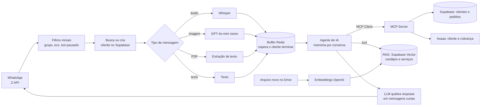

# 02 · Agente de pedidos para restaurante (WhatsApp + MCP)

**Problema.** O delivery de um restaurante familiar dependia de alguém responder o WhatsApp, enviar o cardápio certo para cada horário, anotar o pedido, calcular o total e cobrar.

**Solução.** São dois workflows:
- **`agente-whatsapp.json`:** recebe as mensagens, entende texto, áudio, imagem e PDF, junta mensagens picotadas e conversa com o cliente.
- **`mcp-server-pedidos-pagamentos.json`:** um servidor MCP que expõe ao agente as ferramentas de clientes, pedidos e pagamentos.

## Decisões técnicas
- **Buffer de mensagens no Redis.** Clientes mandam "oi", "quero", "uma marmita" em três mensagens. O fluxo acumula as mensagens e só responde quando o cliente para de digitar, o que evita três respostas desencontradas.
- **MCP para separar responsabilidades.** As ferramentas de negócio (ler e atualizar clientes, criar pedidos, gerar cobrança) ficam num servidor MCP. O agente conversa e o servidor executa, e as ferramentas podem ser reaproveitadas por outros agentes.
- **Confirmação antes de gravar.** O prompt obriga a confirmar itens e endereço antes de `Criar_pedido`, porque um pedido criado não é alterado.
- **Cálculo por ferramenta.** O total vem da `calculadora`, não da "conta de cabeça" do modelo.
- **RAG alimentado pelo Drive.** Ao subir um arquivo novo na pasta, ele é dividido, vetorizado e indexado no Supabase, e o agente consulta essa base para responder sobre o cardápio e os serviços.
- **Cardápio por horário.** Antes das 15h o agente envia a imagem das marmitas. Depois, envia o PDF do cardápio da noite.
- **Handoff humano.** Uma flag no Redis desativa o bot quando um atendente assume a conversa.

## Origem
A estrutura de buffer, a de tratamento multimodal e a de quebra de respostas partem da base ensinada na formação NoCode Startup. O que eu adaptei:
- o prompt e o fluxo de pedido;
- o servidor MCP com Supabase e Asaas;
- o RAG via Drive;
- a lógica de cardápio por horário.

## Status
Protótipo funcional. A cobrança roda no **sandbox** do Asaas, e o fluxo não foi colocado em produção.

## Limitações e próximos passos
- **Exposição de dados:** `LER_clientes` e `LER_pedidos` retornam a tabela inteira e confiam no prompt para não expor dados de terceiros. O certo é filtrar por `cliente_id` no próprio nó.
- Validar o cardápio (itens e preços) contra o banco em vez do texto livre do pedido.
- Adicionar um webhook do Asaas para confirmar o pagamento e atualizar o status do pedido.

**Stack:** n8n · OpenAI (GPT-4.1-mini, GPT-4o-mini, Whisper, Embeddings) · LangChain Agent · MCP · Redis · Supabase (Postgres + pgvector) · Asaas · Z-API · Google Drive
