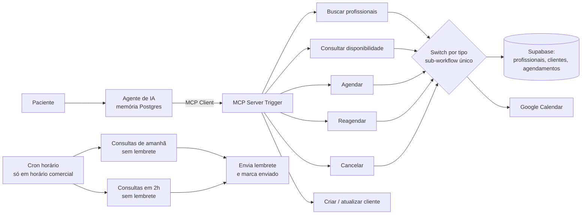

# 03 · Agente de agendamento com MCP e lembretes

**Problema.** Clínicas perdem tempo marcando, remarcando e confirmando consultas pelo WhatsApp, e sofrem com faltas.

**Solução.** Um agente conversacional que lista profissionais por especialidade, consulta disponibilidade, agenda, reagenda e cancela consultas no Google Calendar, mantendo o Supabase como fonte da verdade. Dois gatilhos agendados enviam lembretes 24h e 2h antes de cada consulta.

## Decisões técnicas
- **Um sub-workflow para todas as ações.** Todas as ferramentas MCP chamam o mesmo workflow com um campo `tipo`, e um Switch distribui. Isso centraliza validações como "profissional existe?" e "horário livre?".
- **Mensagens de erro como retorno da ferramenta.** Quando o ID está errado ou o horário está ocupado, a ferramenta devolve um texto que orienta o agente (ex.: "execute buscar profissionais") em vez de falhar.
- **Idempotência nos lembretes.** As flags `lembrete_1dia` e `lembrete_2hs` evitam envio duplicado, e o filtro de horário comercial impede mensagens de madrugada.

## Origem e status
Este é um **projeto de estudo** baseado em uma aula da formação NoCode Startup (o prompt de exemplo ainda cita a clínica fictícia do curso), que expandi e usei como laboratório de MCP. A mesma lógica de lembretes 24h/2h foi aplicada depois no sistema de gestão que desenvolvi para uma clínica de estética.

## Limitações
- O envio do lembrete está com um placeholder no nó HTTP: aponte para a sua API de WhatsApp.
- O texto do lembrete tem erros de digitação herdados do rascunho. O ideal é guardar os modelos de mensagem no banco.

**Stack:** n8n · MCP · OpenAI · Postgres Chat Memory · Supabase · Google Calendar
