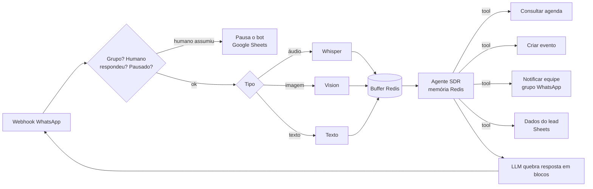

# 04 · SDR de pré-vendas com agendamento de reunião

**Problema.** Leads que preenchiam o formulário de uma empresa do setor imobiliário esfriavam antes de alguém chamá-los no WhatsApp para marcar a reunião comercial.

**Solução.** Um agente de pré-vendas que assume a conversa no WhatsApp com um único objetivo: levar o lead até uma reunião marcada no Google Calendar e avisar a equipe.

## Decisões técnicas
- **Escopo fechado.** O lead já está identificado pelo formulário. O agente é proibido de pedir dados pessoais e só pergunta o dia e o horário da reunião, o que dá menos atrito e menos risco de alucinação.
- **Regras de tempo explícitas:**
  - injeta a data, a hora e o fuso atuais no prompt;
  - recusa pedidos de "agora" e só aceita a partir de +1h;
  - respeita a janela das 08h às 21h;
  - confere se o dia da semana bate com a data calculada antes de criar o evento.
- **Handoff humano.** Quando um atendente responde pelo mesmo número, o fluxo detecta a mensagem enviada pelo humano e pausa o bot para aquele contato. A pausa é registrada em planilha e pode ser reativada.
- **Notificação da equipe.** Toda reunião criada gera um aviso no grupo interno.

## Status
Desenvolvido para um cliente. Os nomes, números, planilhas e calendários foram anonimizados.

## Limitações
- O controle de pausa em Google Sheets funciona para baixo volume. Em escala, o melhor é guardar esse estado no Redis ou no Postgres.
- Não há confirmação ou lembrete automático da reunião (dá para reaproveitar o padrão do projeto 03).

**Stack:** n8n · OpenAI · LangChain Agent · Redis · Google Calendar · Google Sheets · Uazapi / Evolution API
