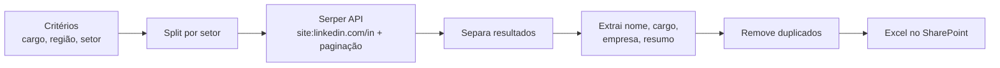

# 05 · Captação de leads no LinkedIn

**Problema.** No time comercial onde atuei em 2025, montar uma lista de prospecção (pessoas com determinado cargo, em determinada região, em empresas de um setor) era feito manualmente no LinkedIn e levava **cerca de 3 horas por lista**.

**Solução.** Um sub-workflow que recebe os critérios (cargo, localização e setor), pesquisa perfis públicos via Google (Serper API), extrai nome, cargo e empresa de cada resultado, remove duplicados e grava tudo numa planilha Excel compartilhada com o time.

## Resultado
O tempo de montagem da lista caiu de **cerca de 3 horas para cerca de 5 minutos** por execução, com **mais de 100 perfis** dentro dos critérios por rodada. Os números foram medidos no uso real pelo time comercial.

## Decisões técnicas
- **Busca via Google, não via scraping do LinkedIn.** O operador `site:linkedin.com/in` sobre resultados públicos evita login e scraping direto da plataforma.
- **Parsing pelo padrão do título.** O nome e o cargo vêm do padrão `Nome - Cargo - Empresa` do título, e a empresa vem do subtítulo.
- **Sub-workflow.** O fluxo é acionado por outro workflow com os critérios, então o mesmo motor serve para listas diferentes.

## Limitações (honestas)
- Esta versão não usa LLM: a "qualificação" é feita pelos filtros de busca. Um próximo passo natural é um LLM pontuar o fit de cada perfil com o ICP.
- O nó `empresas`, um filtro extra por setor, ficou desconectado no export original e está documentado aqui como pendência.
- O parsing depende do formato do título do Google e pode falhar quando o formato muda.

**Stack:** n8n · Serper API · Microsoft Excel (SharePoint)
