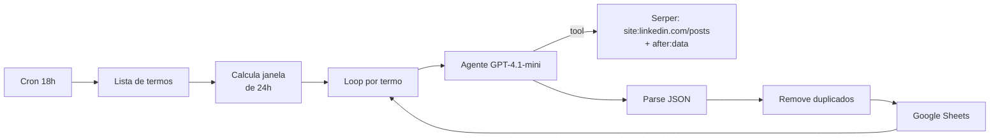

# 06 · Agente de busca de vagas de IA

**Problema.** As vagas de IA e automação muitas vezes são divulgadas em posts do LinkedIn, não em portais, e somem do feed rápido.

**Solução.** Todos os dias às 18h, um agente pesquisa posts recentes de vagas para 12 termos ("AI Engineer", "Agentes de IA", "n8n", "LLM", "RAG"...), valida que cada post é realmente uma vaga e é das últimas 24h, e grava o resultado estruturado numa planilha.

## Decisões técnicas
- **Duas camadas de recência.** O `after:` do Google filtra por data, não por hora. Por isso o agente recebe a janela exata (`dataHoraInicio` → `dataHoraAtual`) e descarta o que não consegue confirmar como recente. A regra é ser conservador e preferir menos vagas a falsos positivos.
- **Critério de qualificação explícito no prompt:** o post precisa ser vaga, contratação ou processo seletivo. Notícias, cursos e eventos ficam de fora.
- **Saída JSON estrita** com parse defensivo e erro descritivo se o modelo devolver algo fora do formato.

## Correção feita na versão pública
- **Variável de janela:** no original, o nó `Edit Fields` não repassava `dataHoraInicio` ao agente, então a janela de 24h chegava vazia no prompt. Corrigido.
- **Pendência de deduplicação:** o `Remove Duplicates` compara só dentro de cada termo. A mesma vaga encontrada por dois termos, ou já gravada em dias anteriores, ainda pode se repetir. O próximo passo é deduplicar pelo link contra a planilha.

**Status:** uso pessoal.

**Stack:** n8n · OpenAI GPT-4.1-mini · LangChain Agent · Serper API · Google Sheets
