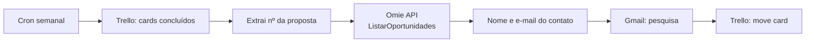

# 07 · Pesquisa de satisfação pós-venda (Trello + Omie + Gmail)

**Problema.** Depois de cada serviço entregue, a equipe de qualidade precisava descobrir quem era o contato do cliente no CRM e enviar a pesquisa de satisfação à mão. Muitas pesquisas não eram enviadas.

**Solução.** Toda segunda às 11h, o fluxo:
1. lê os cards da lista "concluídos" no Trello;
2. extrai o número da proposta do título do card;
3. busca a oportunidade no CRM da Omie;
4. envia por Gmail o e-mail personalizado com o link da pesquisa;
5. move o card para a lista "pesquisa enviada".

## Decisões técnicas
- **O Trello como fila de trabalho.** Mover o card depois do envio garante que cada cliente receba a pesquisa uma vez só.
- **Omie via API HTTP**, com `app_key` e `app_secret` em variáveis de ambiente.

**Status:** usado em produção em 2025, na empresa onde atuei como bolsista.

**Observação:** no export, o nó `separar_omie` está com valores de teste. Mapeie o nome e o e-mail a partir da resposta da Omie.

**Stack:** n8n · Trello · Omie API · Gmail
