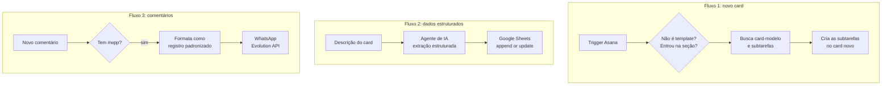

# 08 · Automação de projetos no Asana

**Problema.** Uma equipe de atendimento criava os cards de cada novo caso no Asana à mão, copiando as subtarefas de um card-modelo. Depois, ainda passava as informações da descrição para uma planilha e avisava as pessoas envolvidas pelo WhatsApp.

**Solução.** O workflow tem três fluxos, disparados por eventos do Asana em dois projetos:

## Decisões técnicas
- **Filtro de template.** Ignora eventos do próprio card-modelo, para evitar laços.
- **Extração com IA para planilha.** A descrição livre vira campos estruturados, gravados com upsert para não duplicar linhas.
- **Opt-in por hashtag.** Só os comentários marcados com `#wpp` são enviados. Isso dá à equipe o controle do que vira mensagem externa.
- **API REST do Asana** para os endpoints que o nó nativo não cobre, como a busca de comentários e a descrição de subtarefas.

**Status:** desenvolvido para um cliente. Os nomes de projetos, IDs e contatos foram anonimizados.

**Stack:** n8n · Asana (trigger, nós nativos e API REST) · OpenAI · Google Sheets · Evolution API
